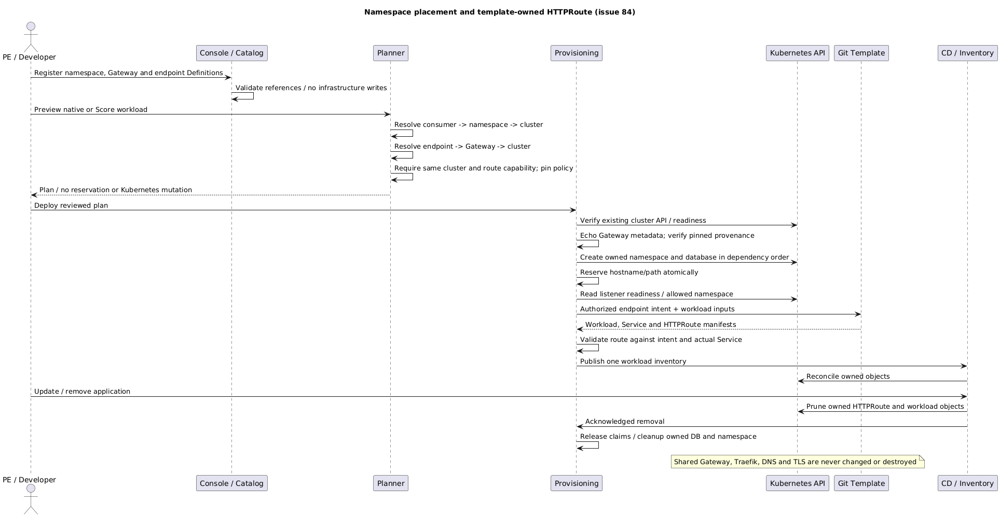

# Namespace providers, existing Gateway and template routes

[ADR-043](../decisions/ADR-043-namespace-placement-template-routes.md) owns the
accepted boundary. This contract supplements the endpoint and Terraform contracts.
Implementation/verification status is separate in the [handoff](../../implementation/namespace-template-routes.md).

## NP-01 — Namespace provider binding

A Kubernetes module can bind its provider to a `k8s-namespace` descriptor with
`target: resource`. Its `variables.namespace` must be a whole reference to that
same descriptor's nonsecret string `name` output; input mapping cannot override
it. Namespace Definitions bind directly to clusters, never another namespace.
Registration validates shape/type; planning selects the namespace's actual
Definition and pins its cluster descriptor, account/version and namespace
descriptor. Missing, contradictory or ambiguous targets fail before effects.

The dependency is consumer → namespace → cluster. Invocation resolves namespace
name and cluster identity from those exact nodes, checks namespace provenance,
and keeps original state/dependency identities. Existing cluster bindings and
AWS account/region bindings retain their contract. No cluster credential is
inferred from a namespace display name.

## GW-01 — Separate preexisting Gateway resource

Resource Type `k8s-gateway` has no Developer inputs and a nonsecret required `any`
output `gateway`. Its new `echo` Definition takes no Driver Account,
Terraform module or template source. The single variable `gateway` is an object containing a whole `cluster` output
reference plus the nonsecret endpoint policy fields: `rootDomain`, `scheme`,
`gatewayName`, `gatewayNamespace`, optional `gatewaySectionName` and `reservedNames`.
No Gateway policy is stored in cluster Definition variables.

The cluster reference forms a graph edge and carries the existing cluster/EKS
target identity. Planning and Preview are read-only and make no Kubernetes calls.
Metadata provisioning verifies pinned cluster/account provenance without a
Kubernetes call; the pre-render target verifier reads Gateway/listener support. The Gateway is PREEXISTING; no apply, adoption, ownership label or destroy
operation is permitted. Gateway UID is observation evidence, not app ownership. The Echo output equals
the expanded variables and never grants physical ownership. A valid Gateway Type
with a supported metadata driver is required; matching an output name alone is
insufficient. Other Echo resources are not implicitly PREEXISTING.
Unreachable, unready or unavailable configured listeners fail before render/CD.

Legacy `existing-gateway` keeps its flat variables and adapter. Both layouts
validate the same policy and whole typed cluster target, forbid developer params,
Driver Account, source, extra output envelopes and secret-derived metadata. New
Echo Gateway registration requires exactly one required nonsecret `any` output
`gateway`; credentials remain in the referenced cluster account. The executor is
generic identity transformation and receives no Connection/Target; the service
retains logical cluster provenance for explicit legacy-to-Echo upgrades.

```yaml
driverType: echo
driverInputs:
  values:
    variables:
      gateway:
        cluster: "${resources['k8s-cluster.internal#environments.@app.@env'].outputs.cluster}"
        rootDomain: apps.example.com
        scheme: https
        gatewayName: public
        gatewayNamespace: gateway-system
        gatewaySectionName: websecure
```

## GW-02 — Endpoint selects Gateway

The new endpoint Definition has exactly one variable:

```yaml
gateway: "${resources['k8s-gateway.default#environments.@app.@env'].outputs.gateway}"
```

The reference must match a registered Gateway Type/Definition. Planning resolves
the policy from the selected immutable Gateway Definition and checks that its
cluster is the consuming workload namespace's cluster. Policy and revisions enter
the plan/hash; no fallback to another Gateway, Environment account or literal
policy is allowed. Workload params remain `name`, named Service `port`, and `path`.

Before publishing, the read-only Gateway verifier checks listener readiness,
HTTPRoute support, hostname and allowed namespaces (All, Same or selector).
Existing hostname/path reservations remain globally scoped as EP-03/05/07 require.

## RT-01 — Authorized neutral input

`execution.RenderRequest.Endpoint` becomes `.Input.endpoint`, either null or a
nonsecret object with `name` (stable route identity), `hostname`, `port` (Service
port name), `path`, `gatewayName`, `gatewayNamespace`, optional `gatewaySectionName`.
It contains no Kubernetes manifest, credentials, runtime clients or reservation
repository. Platform-authorized labels remain `.Input.identity.labels`.

## RT-02 — Git renders; platform validates

The selected source must declare capability `endpoint-httproute-v1`; absent
support fails planning before provisioning. Its ordered resource template reads
the actual rendered Service from `.Manifests`, resolves exactly one named port
and constructs HTTPRoute. The new path never fills in a missing route in Go.

The guard requires exactly one `gateway.networking.k8s.io/v1` HTTPRoute with the
authorized stable name, workload namespace and ownership labels, one hostname,
one Gateway parent/listener, one PathPrefix match and one local Service backend
at the actual numeric Service port. Missing/ambiguous Services, ExternalName,
non-TCP, duplicate routes, altered routing policy, extra rules/backends/parents,
Ingress or Gateway publication are refused before CD. HTTPRoute is ordinary
workload inventory and is delivered/pruned by the existing CD lifecycle.

## RT-03 — Explicit transition and compatibility

Legacy literal endpoint Definitions and old source content are not rewritten.
Their backend-rendering path stays explicit; new Gateway-bound endpoints always
require the new capability. Renderer code changes may require explicit
re-inspection/reselection under ADR-041; old pins and applied objects are retained,
never silently repinned. New backend/template revisions must be selected together.
No schema reset, destructive migration, claim release on failure or removal of
ownership/UID cleanup guards. Cloud database Definitions are independent.

## Console authoring

PE/Admin creates a Gateway Definition in the existing Resource Definition shell,
with cluster reference and existing Gateway policy. New endpoint forms show only
the Gateway resource reference; stored legacy endpoint forms remain editable.
Database provider controls can select a namespace class without repeating a
cluster; advanced JSON round-trips both namespace and legacy cluster bindings.
Developer workload endpoint fields remain name/port/path. No shell/navigation
or unrelated screen redesign is part of this change.

## Collaboration



Source: [sequence](namespace-template-routes.puml). UC-03 owns registration;
UC-05 owns Preview, UC-06 execution and UC-07 update/removal. Existing cluster and
Gateway objects remain outside app cleanup throughout this sequence.
