# DEV — Triển khai acceptance app từng bước

Bài thực hành đưa ba workload `backend`, `worker`, `frontend` lên môi trường
`staging`. Bạn sẽ khai báo PostgreSQL, Redis, biến môi trường, Service nội bộ
và đường dẫn công khai, sau đó kiểm tra một job từ đầu đến cuối.

Ảnh minh họa theo ứng dụng `acceptance-dev-guide`, từ lúc chưa có workload
đến khi lưu ba bản nháp. Các ảnh dừng trước bước Preview/Deploy.

## Trước khi bắt đầu

Nhờ Platform Engineer chuẩn bị cho ứng dụng/môi trường thực hành:

- Tài khoản DEV và địa chỉ Console.
- Ba image acceptance app có tag cụ thể: backend, worker, frontend; image phải
  truy cập được từ môi trường triển khai. Gọi ba địa chỉ đó là `BACKEND_IMAGE`,
  `WORKER_IMAGE`, `FRONTEND_IMAGE` trong bài. Thay bằng địa chỉ thật khi nhập;
  không nhập nguyên các tên giữ chỗ này vào trường image.
- Class workload và mẫu thực thi Deployment được hỗ trợ. Môi trường chụp ảnh
  dùng class `git-dev`, mẫu backend/frontend/worker phiên bản `1.0.0`.
- Resource Definition cho workload, namespace, PostgreSQL và Redis; mẫu này dùng
  class `in-cluster` cho PostgreSQL/Redis.
- Kết nối triển khai CD đã được platform chuẩn bị. Kho secret dùng cho bài này
  là **Git dev Vault**; chọn và lưu kho khi tạo secret nếu app mới chưa có kho.
- Domain/route truy cập nếu cần public frontend. DNS và TLS do platform chuẩn bị.

Bạn không cần tự tạo cluster, Definition hoặc cấu hình CD trong bài này. Nếu
không thấy loại resource hoặc mẫu cần chọn, gửi tên ứng dụng/môi trường cho
Platform Engineer trước khi tiếp tục.

### Bạn sẽ tạo những gì?

| Workload | Công việc | Resource | Service | Public |
|---|---|---|---|---|
| backend | Nhận, lưu và đọc job | PostgreSQL, Redis | `http:8080` | Không |
| worker | Xử lý job trong PostgreSQL, ghi cache Redis | Dùng chung DB/cache của backend | Không | Không |
| frontend | Hiển thị web, chuyển tiếp `/api` tới backend | Service backend | `http:8080` | `/` nếu cần |

Luồng kiểm tra: frontend → backend → PostgreSQL → worker → frontend.
Backend và worker phải dùng cùng database, cache và các giá trị phân vùng cache.

## 1. Tạo ứng dụng

1. Đăng nhập Console bằng tài khoản DEV.
2. Chọn **Tiếng Việt** ở phần ngôn ngữ để nhãn khớp bài hướng dẫn.
3. Nhấn **Ứng dụng** ở thanh bên trái.
4. Nhấn **+ Tạo ứng dụng**.
5. Tại **Tên ứng dụng**, nhập `acceptance-dev-guide`.
6. Tại **Subdomain**, nhập `acceptance-dev-guide`. Nếu đã có người dùng, chọn
   một tên khác và dùng tên đó xuyên suốt bài.
7. Nhấn **Tạo ứng dụng**.
8. Trên trang ứng dụng, chọn tab **staging**.
9. Kiểm tra dòng **Môi trường này chưa có Workload nào.**, phần tài nguyên chưa
   có dữ liệu và chưa có lịch sử triển khai.

**Kết quả:** trang ứng dụng có môi trường `staging` và `production`. Tạo ứng dụng
chưa triển khai container nào.

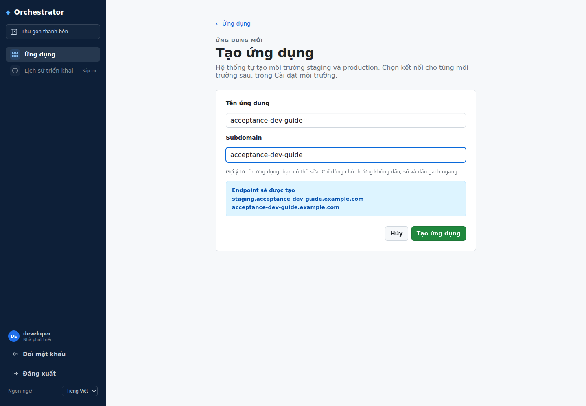

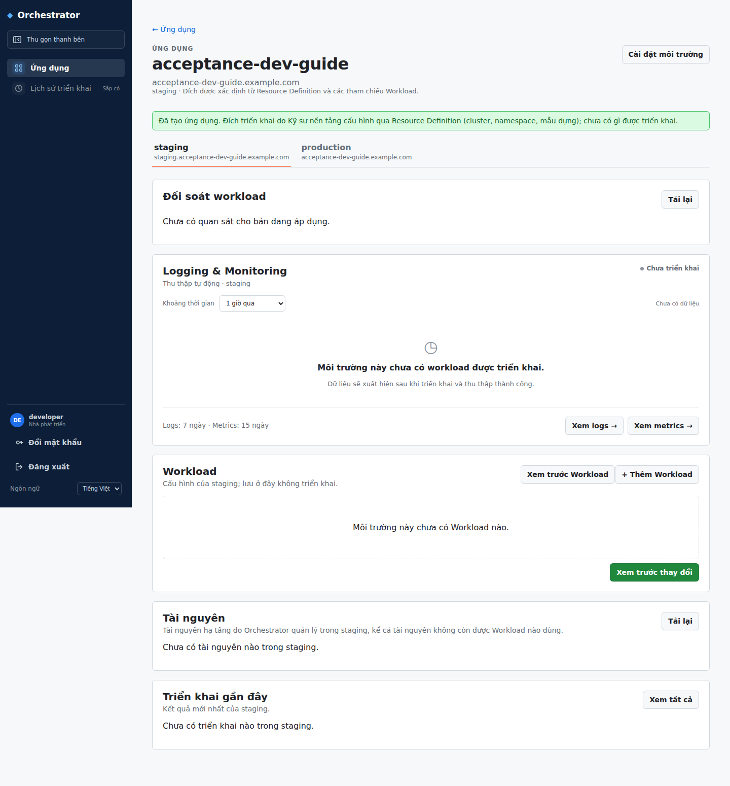

## 2. Thêm workload backend

### 2.1. Chọn mẫu và image

1. Trên tab **staging**, nhấn **+ Thêm Workload**.
2. Trong **Chọn loại workload**, nhấn **Backend API** (`Deployment · 1.0.0`). Nếu chưa có mẫu phù hợp, dừng và nhờ Platform Engineer chuẩn bị mẫu;
   không chọn mẫu tùy ý để tiếp tục.
3. Ở **Thông tin cơ bản**, điền **Tên Workload** là `backend`.
4. Điền **Class Workload (metadata.class)** theo thông tin platform; môi trường
   ví dụ dùng `git-dev`.
5. Đặt **Số replica** là `1`.
6. Trong **Container 1**, điền **Tên Container** là `main`.
7. Tại **Ảnh Container**, dán địa chỉ `BACKEND_IMAGE` thật.
8. Nhấn **Hiện nâng cao** ngay dưới phần thông tin tài nguyên container.
9. Điền **Yêu cầu CPU** `50m`, **Yêu cầu bộ nhớ** `64Mi`, **Giới hạn CPU**
   `500m`, **Giới hạn bộ nhớ** `256Mi`.
10. Giữ nguyên các trường khác trong phần nâng cao cho bước thực hành này.

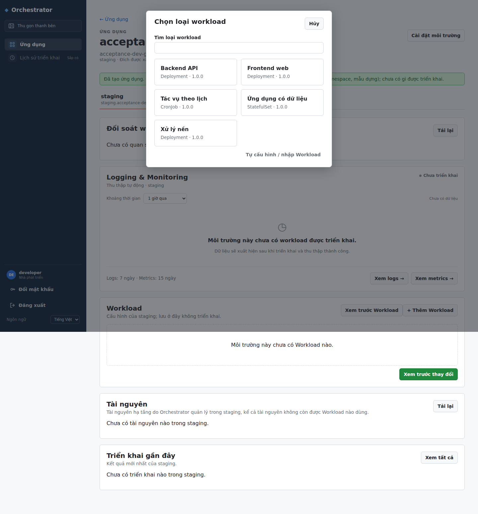

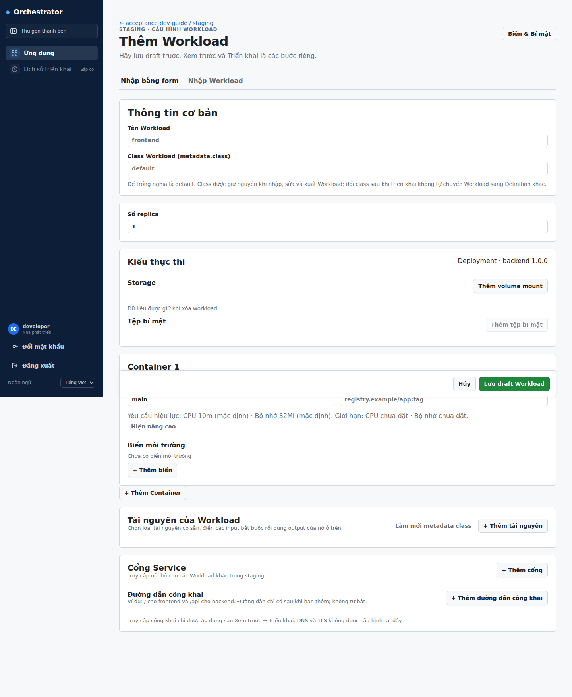

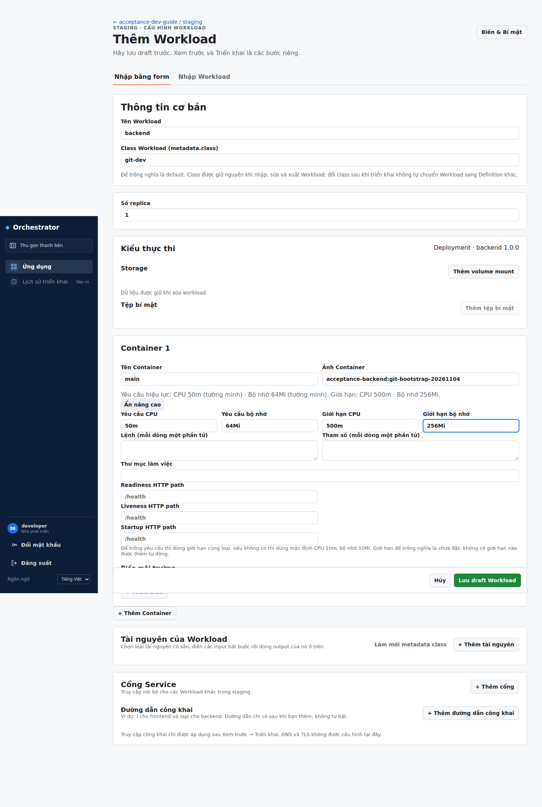

### 2.2. Thêm resource PostgreSQL

1. Cuộn xuống **Tài nguyên của Workload**.
2. Nhấn **+ Thêm tài nguyên**.
3. Ở dòng mới, chọn **Nguồn tài nguyên** → **Tạo resource mới**.
4. Điền **Alias tài nguyên** là `db`.
5. Chọn **Loại tài nguyên** là `postgres`.
6. Tại **Cách cung cấp / Class**, chọn **Trong cluster (in-cluster)** theo môi
   trường ví dụ.
7. Điền tham số `database` là `acceptance`, `username` là `app`.
8. Giữ tài nguyên ở chế độ **Dùng chung trong ứng dụng / môi trường** để worker
   dùng lại. Không bật lựa chọn resource riêng trong phần nâng cao.

Alias `db` dùng để chọn output ở bước sau. Không cần tự nhập hostname hay mật
khẩu database; Orchestrator lấy chúng từ tài nguyên được cấp.

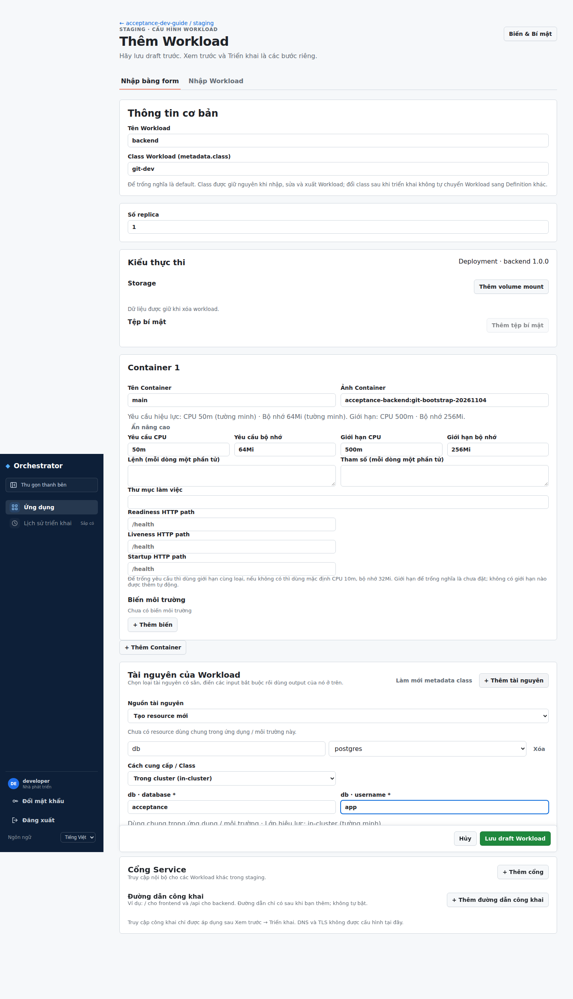

### 2.3. Thêm resource Redis

1. Nhấn **+ Thêm tài nguyên** lần nữa.
2. Chọn **Nguồn tài nguyên** → **Tạo resource mới**.
3. Điền **Alias tài nguyên** là `cache`.
4. Chọn **Loại tài nguyên** là `redis`.
5. Chọn **Cách cung cấp / Class** → **Trong cluster (in-cluster)**.
6. Giữ chế độ dùng chung. Điền thêm input bắt buộc nếu platform của bạn công bố
   input khác; nếu khác mẫu bài này, nhờ platform xác nhận trước khi deploy.

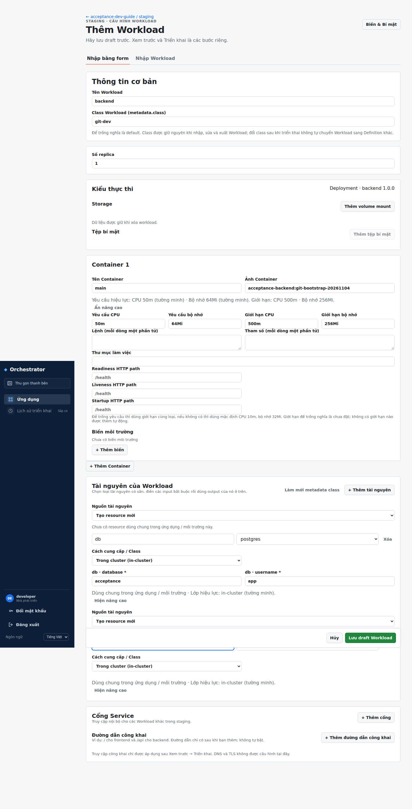

### 2.4. Thêm biến môi trường từ resource

1. Cuộn lên bảng **Biến môi trường** của container `main`.
2. Nhấn **+ Thêm biến**.
3. Ở cột **Tên biến**, nhập `PGHOST`.
4. Cùng dòng đó, nhấn **Chọn từ…**.
5. Trong hộp **Chọn giá trị có sẵn**, nhập `db.host` vào ô tìm kiếm.
6. Chọn `db.host` trong nhóm **Output tài nguyên**.
7. Lặp lại thao tác thêm dòng và chọn nguồn theo bảng sau:

| Tên biến | Output cần chọn |
|---|---|
| PGHOST | `db.host` |
| PGPORT | `db.port` |
| PGDATABASE | `db.database` |
| PGUSER | `db.username` |
| PGPASSWORD | `db.password` |
| REDIS_HOST | `cache.host` |
| REDIS_PORT | `cache.port` |
| REDIS_USERNAME | `cache.username` |
| REDIS_PASSWORD | `cache.password` |
| REDIS_TLS | `cache.tls` |

Chọn output mật khẩu có nhãn **Bí mật**. Không sao chép mật khẩu vào ô giá trị
thường. Nếu thiếu output cần dùng, kiểm tra lại alias/loại tài nguyên.

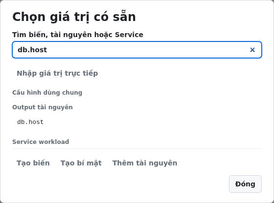

### 2.5. Thêm biến có giá trị thường

Với mỗi dòng dưới đây: nhấn **+ Thêm biến**, nhập tên ở cột **Tên biến**, rồi
nhập trực tiếp ở cột **Giá trị**. Nếu mẫu đã có dòng cùng tên, sửa dòng đó;
không thêm tên biến trùng.

| Tên biến | Giá trị thực hành |
|---|---|
| PORT | `8080` |
| ACCEPTANCE_CONFIG | `acceptance-config-ok` |
| ACCEPTANCE_CACHE_APP | `acceptance-dev-guide` |
| ACCEPTANCE_CACHE_ENV | `staging` |
| ACCEPTANCE_CACHE_RUN | `dev-guide-01` |
| ACCEPTANCE_CACHE_TTL_SECONDS | `30` |

Nếu dùng tên app khác, sửa `ACCEPTANCE_CACHE_APP` tương ứng. Giữ các giá trị
cache này giống nhau giữa backend và worker.

### 2.6. Khai báo secret kiểm tra của acceptance app

Acceptance app cần `ACCEPTANCE_SECRET` và SHA-256 của nó để xác nhận secret đã
được truyền đúng. Đây là secret của app mẫu, không dùng credential thật của bạn.

1. Nhờ người chuẩn bị bài thực hành cấp một giá trị secret thử nghiệm và chuỗi
   SHA-256 tương ứng (hex chữ thường, 64 ký tự).
2. Nhấn **+ Thêm biến**, nhập tên `ACCEPTANCE_SECRET`.
3. Nhấn **Chọn từ…**, rồi **Tạo bí mật**.
4. Nếu hộp tạo secret có phần **Kho bí mật**, chọn **Git dev Vault** theo bài
   thực hành, nhấn **Lưu kho bí mật**. Với môi trường khác, chọn đúng kho platform
   đã cấp; không chọn tùy ý.
5. Trong hộp tạo secret, điền **Tên key** `ACCEPTANCE_SECRET`, nhập giá trị thử nghiệm
   vào **Giá trị bí mật**, rồi nhấn **Tạo và chọn**. Không đưa giá trị này vào ảnh chụp.
6. Sau khi tạo, kiểm tra dòng biến đang tham chiếu key `ACCEPTANCE_SECRET` và có
   nhãn **Bí mật**. Nếu key đã tồn tại trong môi trường, chọn
   **Ứng dụng / ACCEPTANCE_SECRET** thay vì tạo lại.
7. Thêm biến `ACCEPTANCE_SECRET_SHA256`, nhập chuỗi SHA-256 được cấp vào cột
   **Giá trị**. Hash này là giá trị thường.

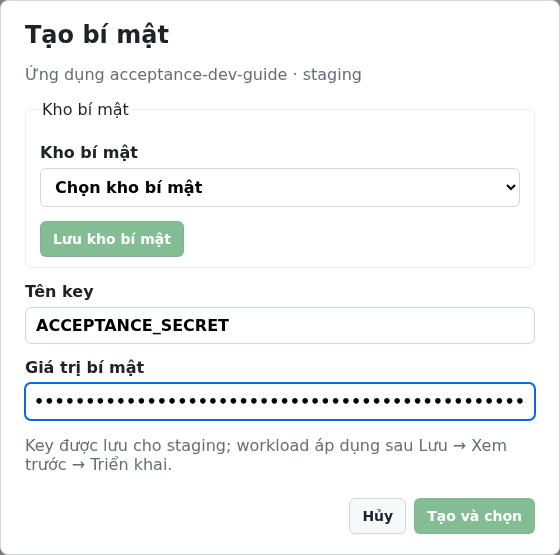

### 2.7. Khai báo Service backend

1. Cuộn xuống **Cổng Service**.
2. Nhấn **+ Thêm cổng**.
3. Nhập **Tên cổng Service** là `http`.
4. Nhập số cổng ở ô **Cổng Service** là `8080`.
5. Để trống cổng đích để dùng cùng `8080`; nếu muốn khai báo tường minh, nhấn
   **Hiện nâng cao** của cổng, điền **Cổng đích của Container** là `8080`.
6. Không bật **Service headless** cho ví dụ HTTP này.
7. Trong **Đường dẫn công khai**, chưa thêm dòng nào cho backend.
8. Nhấn **Lưu draft Workload** ở cuối form.

**Kết quả:** quay về trang ứng dụng; backend có thay đổi chờ triển khai. Lưu draft
chưa tạo database, cache hoặc container đang chạy.

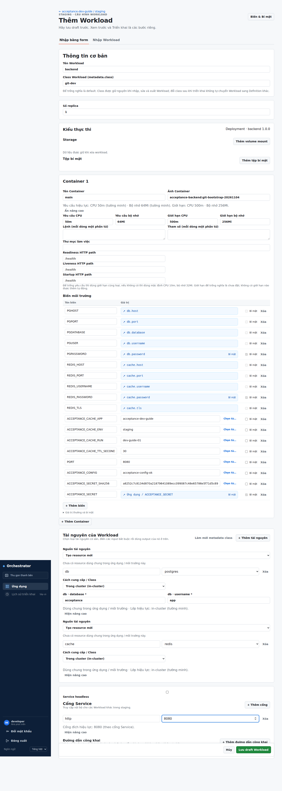

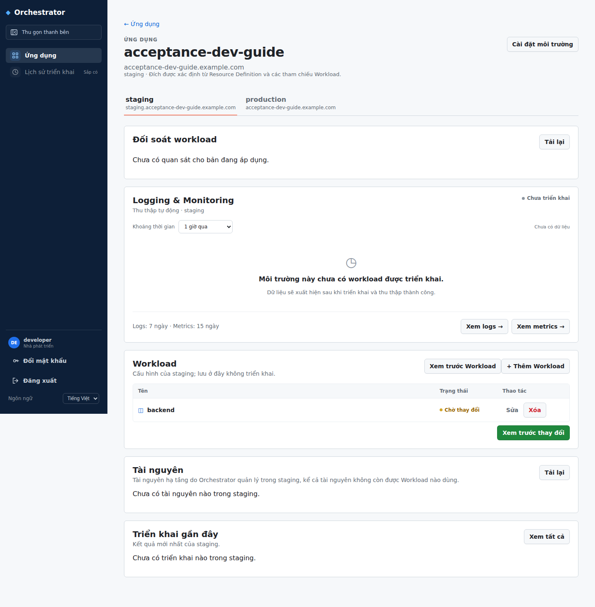

## 3. Thêm workload worker và dùng lại resource

1. Nhấn **+ Thêm Workload**, nhấn **Xử lý nền** (`Deployment · 1.0.0`).
2. Điền tên `worker`, class giống backend, replica `1`.
3. Điền container `main`, địa chỉ `WORKER_IMAGE` thật.
4. Mở **Hiện nâng cao** của container; đặt yêu cầu bộ nhớ `48Mi`, giới hạn bộ
   nhớ `128Mi`. Các trường CPU dùng giá trị platform đã chuẩn bị cho mẫu.
5. Cuộn xuống **Tài nguyên của Workload**, nhấn **+ Thêm tài nguyên**.
6. Tại **Nguồn tài nguyên**, chọn mục `db · postgres · backend` trong nhóm dùng
   tài nguyên có sẵn. Giữ alias là `db`.
7. Nhấn **+ Thêm tài nguyên**, chọn `cache · redis · backend`, alias `cache`.
8. Kiểm tra hai dòng đang dùng lại resource backend. Không chọn **Tạo resource
   mới** ở bước này: worker phải xử lý job trong cùng database với backend.
9. Thêm 10 biến PostgreSQL/Redis và chọn output như bảng ở mục 2.4.
10. Thêm bốn biến `ACCEPTANCE_CACHE_APP`, `ACCEPTANCE_CACHE_ENV`,
    `ACCEPTANCE_CACHE_RUN`, `ACCEPTANCE_CACHE_TTL_SECONDS` với giá trị giống backend.
11. Thêm biến thường `POLL_INTERVAL_MS` bằng `500`.
12. Không thêm cổng Service và không thêm đường dẫn công khai cho worker.
13. Nhấn **Lưu draft Workload**.

**Kết quả:** danh sách có backend và worker. Hai workload cùng tham chiếu DB/cache;
không xuất hiện một cặp resource riêng cho worker.

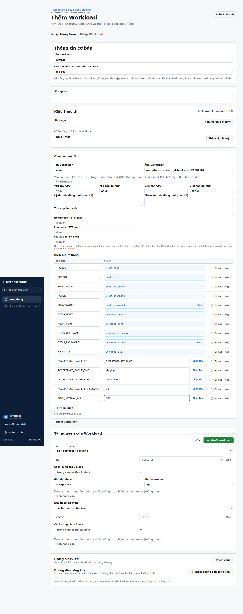

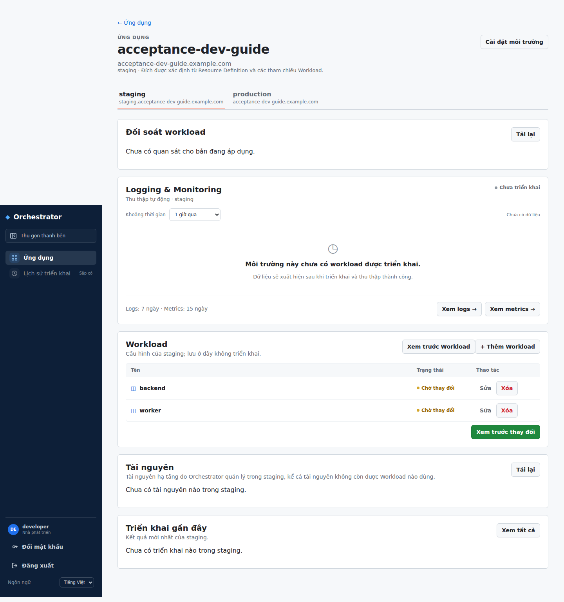

## 4. Thêm workload frontend

1. Nhấn **+ Thêm Workload**, nhấn **Frontend web** (`Deployment · 1.0.0`).
2. Điền tên `frontend`, class như backend, replica `1`.
3. Điền container `main`, địa chỉ `FRONTEND_IMAGE` thật.
4. Trong **Biến môi trường**, thêm `PORT` với giá trị trực tiếp `8080`.
5. Thêm biến `BACKEND_URL`, nhấn **Chọn từ…** ở dòng đó.
6. Tìm `backend`, chọn **backend / http** trong nhóm **Service workload**.
   Không nhập địa chỉ Pod hoặc địa chỉ máy đang chạy Console.
7. Trong **Cổng Service**, nhấn **+ Thêm cổng**; tên `http`, cổng `8080`.
8. Cổng đích để trống hoặc khai báo tường minh `8080` như backend.
9. Giữ nguyên các trường nâng cao còn lại của mẫu cho bài thực hành này.

### Public frontend nếu cần truy cập từ bên ngoài

1. Trong **Đường dẫn công khai**, nhấn **+ Thêm đường dẫn công khai**.
2. Nhập `/` ở ô đường dẫn.
3. Tại **Cổng Service công khai**, chọn `http · 8080`.
4. Nhấn **Lưu draft Workload**.

Nếu chỉ dùng nội bộ, bỏ qua ba thao tác thêm public route và lưu draft. Public
route chỉ có hiệu lực sau deploy; DNS/TLS không được cấu hình trong editor này.
Dùng domain do Platform Engineer xác nhận, không suy từ tên app rằng DNS đã có.

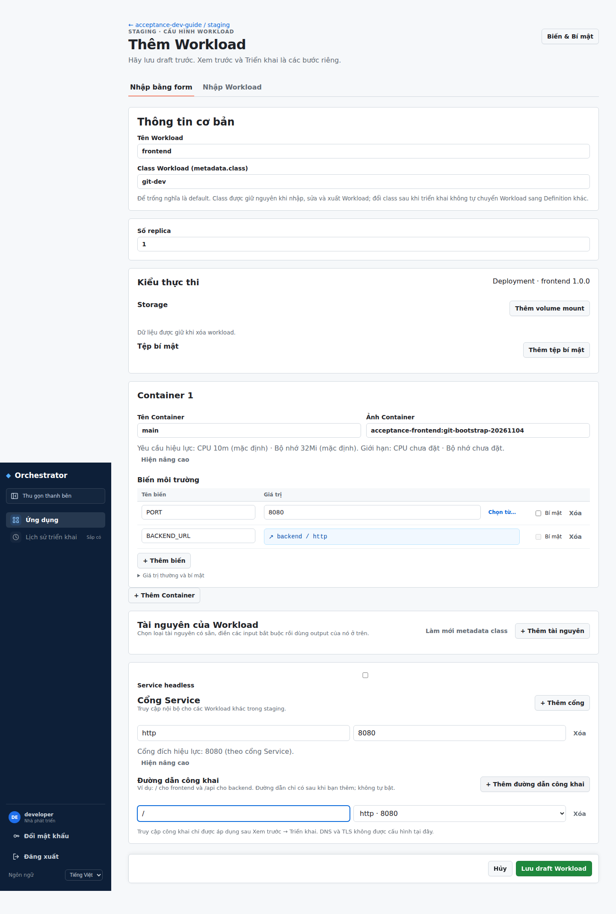

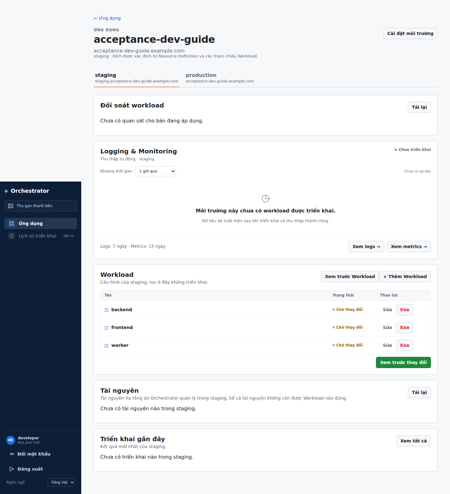

## 5. Preview rồi triển khai

1. Quay về trang ứng dụng, chọn đúng tab **staging**.
2. Kiểm tra có ba dòng `backend`, `worker`, `frontend`.
3. Nhấn **Xem trước thay đổi**.
4. Chờ phần **Xem trước triển khai** xuất hiện.
5. Kiểm tra kế hoạch chứa ba workload đúng image và các tài nguyên liên quan.
   Backend và worker phải dùng chung PostgreSQL/Redis; frontend có Service,
   public route `/` nếu đã khai báo.
6. Nếu có lỗi, đọc thông báo, mở **Sửa** tại workload liên quan, sửa và
   **Lưu draft Workload**, rồi chạy **Xem trước thay đổi** lại.
7. Khi kế hoạch phù hợp, nhấn **Triển khai**.
8. Chờ kết quả trong **Triển khai gần đây**. Đọc riêng trạng thái đồng bộ và
   sức khỏe ở **Đối soát workload** nếu môi trường hiển thị phần này.

**Kết quả cần có:** lần triển khai thành công và ba workload hoạt động. Nếu lỗi
kết nối/CD/Definition, gửi thông báo cho Platform Engineer; không tự đổi các
kết nối platform để thử cho qua lỗi.

Phần Preview/Deploy trong bài chưa được chụp lại bằng lượt triển khai mới; sẽ
bổ sung ảnh sau khi có môi trường thực hành được phép deploy.

## 6. Mở acceptance app và kiểm tra job

1. Mở URL frontend mà môi trường đã cấp. Nếu URL chưa truy cập được, kiểm tra
   public route đã deploy và nhờ platform kiểm tra DNS/Gateway/TLS.
2. Trên trang acceptance app, kiểm tra bảng deployment checks. Các mục cấu hình,
   secret, PostgreSQL, kết nối backend và cache phải đạt.
3. Trong **Job flow**, nhập `hello-dev` vào ô payload cạnh nút **Submit job**.
4. Nhấn **Submit job**, theo dõi dòng job mới. Nhấn **Refresh observations**
   để cập nhật nếu cần; chờ `status` thành `DONE`, kiểm tra `result` là
   `processed:HELLO-DEV` và `processed by` có tên worker.
5. Nếu job chờ mãi, quay về Console kiểm tra worker và kết nối PostgreSQL/Redis.

Chưa có ảnh kết quả của app thực hành vì lượt này dừng ở lưu bản nháp. Không
lấy ảnh job DONE của ứng dụng khác để minh họa kết quả bài này.

## 7. Cập nhật cấu hình đã triển khai

1. Quay lại **Ứng dụng**, mở app thực hành, chọn **staging**.
2. Tại dòng workload cần đổi, nhấn **Sửa**.
3. Thay image hoặc cấu hình mong muốn. Giữ nguyên nguồn dùng chung DB/cache nếu
   muốn tiếp tục sử dụng dữ liệu đang có.
4. Nhấn **Lưu draft Workload**.
5. Nhấn **Xem trước thay đổi**, đọc kế hoạch rồi nhấn **Triển khai**.
6. Chờ hoàn tất, mở lại frontend và kiểm tra job.

Không dùng thao tác lưu draft để kết luận phiên bản đang chạy đã được cập nhật.

## 8. Bài tiếp theo: gắn storage cho backend

Thực hiện khi Platform Engineer đã cung cấp resource `persistent-storage` và mẫu
backend hỗ trợ mount. Đây là phần bổ sung, không bắt buộc cho bài job cơ bản.

1. Tại backend, nhấn **Sửa**.
2. Trong **Storage**, nhấn **Thêm volume mount**. Nếu chưa có resource storage,
   form mở hộp **Thêm tài nguyên lưu trữ**.
3. Chọn loại `persistent-storage`, alias `data`, dung lượng `1Gi`; dùng class do
   platform chuẩn bị. Xác nhận thêm và chọn tài nguyên theo form.
4. Kiểm tra **Tài nguyên storage** là `data`, **Container** là `main`.
5. Nhập **Mount path** `/data`, bỏ chọn **Chỉ đọc**.
6. Trong **Biến môi trường**, thêm `ACCEPTANCE_STORAGE_DIR` bằng `/data`.
7. **Lưu draft Workload** → **Xem trước thay đổi** → **Triển khai**.
8. Trên frontend acceptance app, trong **Persistent storage**, nhập `hello-volume`
   vào **Test value**, nhấn **Write to volume**. Kiểm tra **Stored value** là
   `hello-volume` và **SHA-256** có giá trị.

Xóa workload có thể giữ lại storage. Kiểm tra tài nguyên được giữ trước khi kết
thúc bài; không xóa volume dùng chung để dọn một workload riêng.

## 9. Gỡ workload khi kết thúc bài

Chỉ làm trên ứng dụng thực hành bạn sở hữu.

1. Tại trang ứng dụng, chọn **staging**.
2. Nhấn **Xóa** ở dòng workload muốn gỡ và xác nhận đánh dấu xóa.
3. Kiểm tra trạng thái **Chờ xóa**. Nếu chọn nhầm, nhấn **Hoàn tác**.
4. Nhấn **Xem trước thay đổi** và đọc phạm vi bị gỡ.
5. Nhấn **Triển khai** để áp dụng việc gỡ.
6. Kiểm tra bảng **Tài nguyên**: resource không còn được workload dùng không có
   nghĩa là đã bị hủy. Nhờ platform xử lý phần tài nguyên/dữ liệu còn giữ theo
   quy định của môi trường.

## Khi gặp lỗi

| Hiện tượng | Việc cần kiểm tra |
|---|---|
| Không thấy `postgres` hoặc `redis` | Loại tài nguyên và quyền môi trường; nhờ platform chuẩn bị |
| Không thấy `db.host` trong Chọn từ… | Đã thêm resource alias `db`, chọn đúng loại và metadata đã tải |
| Không thấy `backend / http` | Backend đã lưu draft và có cổng Service tên `http` |
| Job không chuyển DONE | Worker chạy, dùng chung DB/cache, biến cache giống backend |
| Secret check không đạt | Đúng key/môi trường, đúng hash; không chụp hoặc gửi giá trị secret |
| URL public không mở được | Public route đã deploy, đúng Service port; DNS/TLS/Gateway do platform |
| Lưu draft xong app chưa đổi | Cần tiếp tục Xem trước thay đổi → Triển khai |

Khi nhờ hỗ trợ, gửi tên ứng dụng/môi trường, workload, thời điểm, mã triển khai
và thông báo lỗi đã che thông tin nhạy cảm.

## Nguồn đối chiếu và phạm vi xác minh

- [Ứng dụng mẫu](../../../backend/examples/acceptance-app/README.md).
- [Workload backend mẫu](../../../scripts/bootstrap/git-assets/dev/backend.yaml),
  [worker](../../../scripts/bootstrap/git-assets/dev/worker.yaml),
  [frontend](../../../scripts/bootstrap/git-assets/dev/frontend.yaml).
- [Thiết kế workload editor](../../usecase/UC-16/ui/README.md),
  [application home](../../usecase/UC-01/ui/README.md).
- [Generic workload contract](../../architecture/contracts/generic-workload.md).

Ảnh được chụp từ app mới và form đang thao tác theo thứ tự; không thay shell hoặc
pattern UI. Bài được tích hợp vào mục **Hướng dẫn sử dụng** của Console. Ảnh minh họa đã
duyệt được đóng gói thành static product assets trong `frontend/public/guides/`;
capture gốc, session và evidence vẫn nằm ngoài Git.
