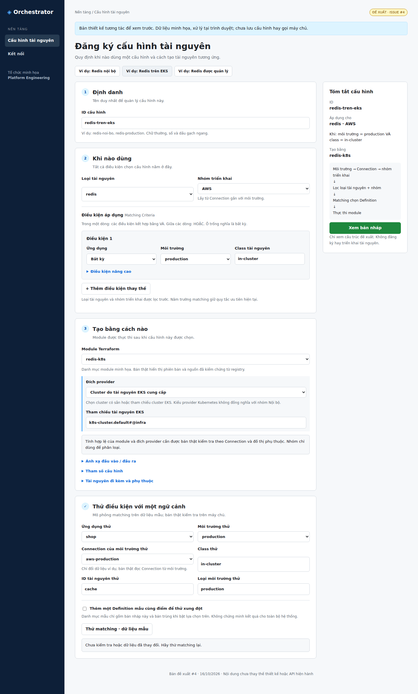
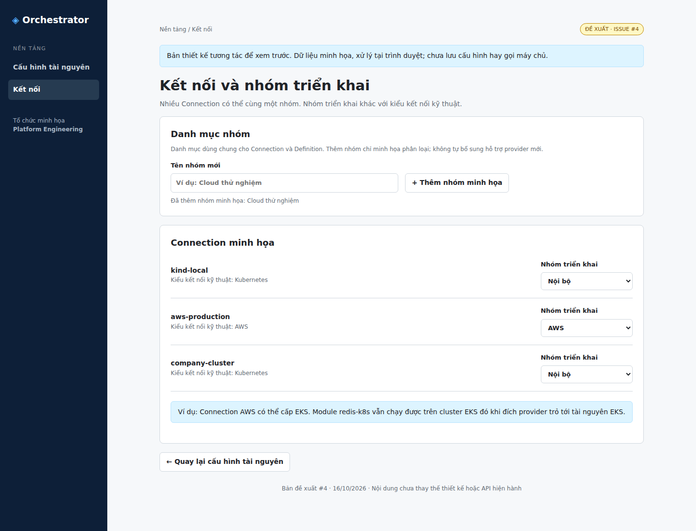

# Đề xuất giao diện Cấu hình tài nguyên — issue #4

[Bản HTML tương tác](definition-redesign.html) phục vụ xem và góp ý cho
[issue #4](https://github.com/pr3s3nt/poc/issues/4). Tải file HTML bằng nút
Download raw file của GitHub, rồi mở bằng trình duyệt. File tự chứa CSS/JS,
không cần cài thư viện, không gọi mạng và không lưu dữ liệu sau tải lại.

Đây là đề xuất, chưa thay thế [UI hiện hành](../screens.md),
[specification UC-03](../../specification.md) hoặc API sản phẩm. Nhánh riêng
`design/issue-4-resource-definition` chưa hợp nhất vào `refactor_ui`.

## Bố cục đề xuất

1. Định danh: ID cấu hình.
2. Khi nào dùng: loại tài nguyên, nhóm triển khai; bên trong là Matching
   Criteria với ứng dụng, môi trường, class và phần nâng cao env_type/res_id.
3. Tạo bằng cách nào: module, đích provider, ánh xạ, tham số và tài nguyên
   đi kèm/phụ thuộc.

Nhóm triển khai là phần mở rộng đề xuất, lọc trước matching. Danh mục nhóm
được dùng chung với Connection, khác kiểu kết nối kỹ thuật Kubernetes/AWS.
Matching giữ năm trường/trọng số hiện tại và chọn criterion khớp có điểm cao
nhất; nhiều Definition đồng hạng cao nhất báo xung đột. Không đưa module
Terraform vào điều kiện matching.

Trang Kết nối minh họa việc gán nhóm và thêm tên nhóm mới. Thêm nhóm không tự
bổ sung khả năng thực thi một provider. Redis trên EKS minh họa trường hợp
Connection AWS đi cùng module Kubernetes và đích provider là tài nguyên EKS.

## Những thao tác có thể thử

- Chọn ba ví dụ Redis: nội bộ, EKS, dịch vụ được quản lý.
- Đổi loại tài nguyên và module; xem tóm tắt cập nhật.
- Thêm/xóa dòng HOẶC; nhập điều kiện nâng cao.
- Thử matching theo ngữ cảnh mẫu, bật Definition trùng để xem xung đột.
- Chuyển trang Kết nối, tạo nhóm minh họa và đổi nhóm của một Connection.
- Nhập JSON tham số/tài nguyên đi kèm và xem cấu trúc bản nháp.

## Giới hạn bản mô phỏng

Dữ liệu ứng dụng, môi trường, Connection và module đều minh họa. Kết quả
matching được tính trong trình duyệt trên bản nháp và tối đa một Definition
trùng giả lập; không phải kết quả API hoặc toàn bộ catalog. Bản thật cần dùng
kiểm tra phía máy chủ và lấy Connection/loại môi trường từ snapshot môi trường.
Đổi bản nháp hoặc ngữ cảnh sẽ làm kết quả cũ mất hiệu lực.

Ánh xạ đang là bảng minh họa chỉ đọc; tham số và provision chỉ có trình nhập
JSON object. Bản thật vẫn cần biểu mẫu typed/JSON lossless, schema validation,
source pins, secret flags, provider graph và toàn bộ controls hiện hành.
Các phần này không được coi là đã triển khai trong mockup. Nút xem bản nháp
không đăng ký hay provision. JSON đề xuất không phải payload API hiện tại.

## Kiểm tra bản HTML

Đã mở bằng Chromium/Playwright tại viewport 1440×1100 và 390×844; không có lỗi
JavaScript hoặc tràn ngang ở viewport điện thoại. Đã thử matching điểm 20,
xung đột đồng hạng, EKS binding, dòng HOẶC/điều kiện nâng cao, module managed,
xem JSON, thêm nhóm và thay nhóm Connection khiến điều kiện không khớp.
Đã xem ảnh chụp desktop/mobile. Checker tài liệu và git diff --check đạt.
Không chạy Go/frontend product suite vì chỉ bổ sung artifact thiết kế độc lập,
không đổi mã sản phẩm hoặc test. Không chạy cluster/AWS.

## Ảnh xem nhanh

