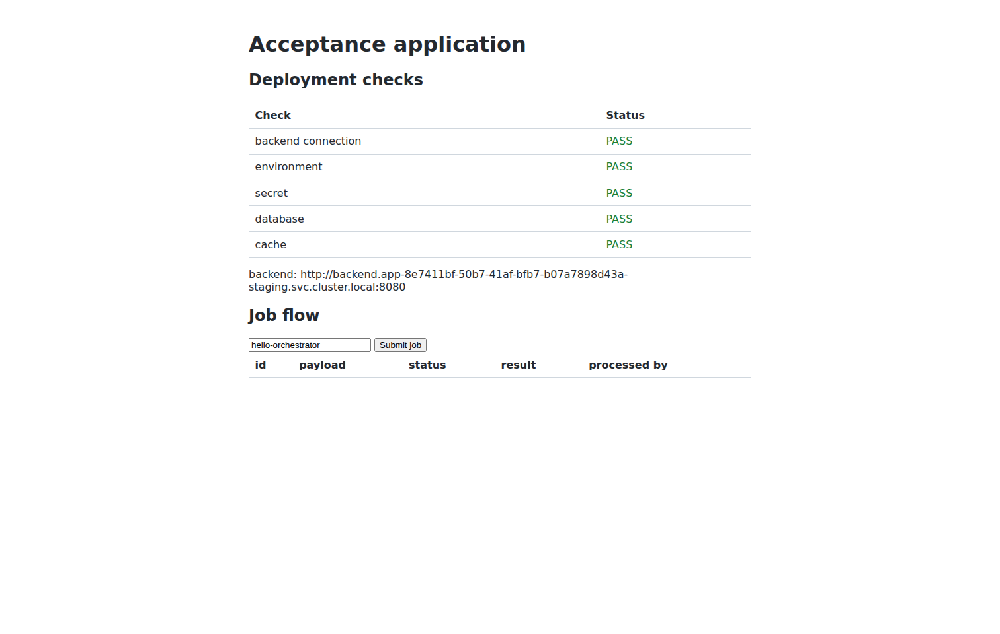

# Open workload object set, inventory and Gateway API routes (ADR-024)

Real end-user run `wmr3` of
[`workload-manifests-kind.sh`](../../backend/test/integration/workload-manifests-kind.sh)
(scenario [`workload-manifests-kind.mjs`](../../frontend/test/e2e/workload-manifests-kind.mjs)):
**36/36 PASS, 0 FAIL, 331 s**, cleanup `final_status=0`, secret scan clean.

| Fact | Value |
|---|---|
| Commit under test | `6dba0fa` (feature branch, merged to `main` afterwards) |
| Bundle | `https://github.com/pr3s3nt/workload-manifests.git` `bundles/production` @ `9d5b31be06f3b0b7d4051296e98f4176514ee5fc` |
| Cluster | new kind `workload-manifests-wmr3`, Envoy Gateway v1.5.0, Gateway `gateway-system/public` (HTTP :80, routes from all namespaces), VSO 1.5.1 |
| Platform | run-owned Compose (PostgreSQL, Vault, backend/frontend built from the tree), real Kubernetes/Terraform adapters, score-k8s 0.15.0, `-public-route-kind httproute` |
| Browser | headed Chromium on Xvfb; Environment host resolved to a loopback port-forward of the Envoy Service, real `Host` header |

| Step | Result |
|---|---|
| WM-E01/E02 | Empty catalog; PE onboarded account, types, Vault store, cluster/namespace/PostgreSQL/Redis Definitions; inspected the public bundle repository and registered the template |
| WM-E03 | Developer imported three Scores; backend with `bundle/autoscale-*`, `bundle/pdb-min-available`, `bundle/migrate`, `bundle/cron.refresh`, `bundle/file.app.yaml`; worker with `bundle/volume.scratch`; frontend public route `/` |
| WM-E04 | Preview listed HPA, PDB, ConfigMap (data redacted), `Job/backend-migrate-preview`, CronJob, PVC; no namespace created |
| WM-E05 | Migration Job completed before the backend ReplicaSet existed; HPA max 3, PDB, ConfigMap mounted at `/etc/app`, CronJob, PVC Bound with `Recreate`; ownership labels on every object; inventory persisted; `HTTPRoute orch-public` `staging.wmwmr3.wm-wmr3.test` `Accepted/ResolvedRefs=True`; browser opened the host through the Gateway and all checks plus a job passed |
| WM-E06 | Annotation-only backend UPDATE: CronJob and previous migration Job deleted after rollout, new Job completed, HPA max 4, inventory updated; domain and business flow still pass |
| WM-E07 | Product removal: no workload-owned object left, HTTPRoute removed, every resource DESTROYED, namespace absent, no browser errors |

Runs `wmr1` and `wmr2` failed at WM-E05.httproute only because the scenario read
route conditions too early (r1) and from the wrong field (`parents[].status`
instead of `parents[].conditions`, r2); both cleaned up with verified absence.
The scenario was corrected; no product change was needed.

Focused checks: `go test ./...`, `go build ./...`,
[`TestOpenObjectLifecycleOnKind`](../../backend/internal/adapters/kubernetes/objects_kind_test.go)
on a disposable kind cluster with Envoy Gateway (cluster-scoped refusal, foreign
object refusal, Job then rollout, HTTPRoute accepted, UID removal, foreign object
kept), bundle examples via `RENDER_BUNDLE_DIR`, docs checker.

