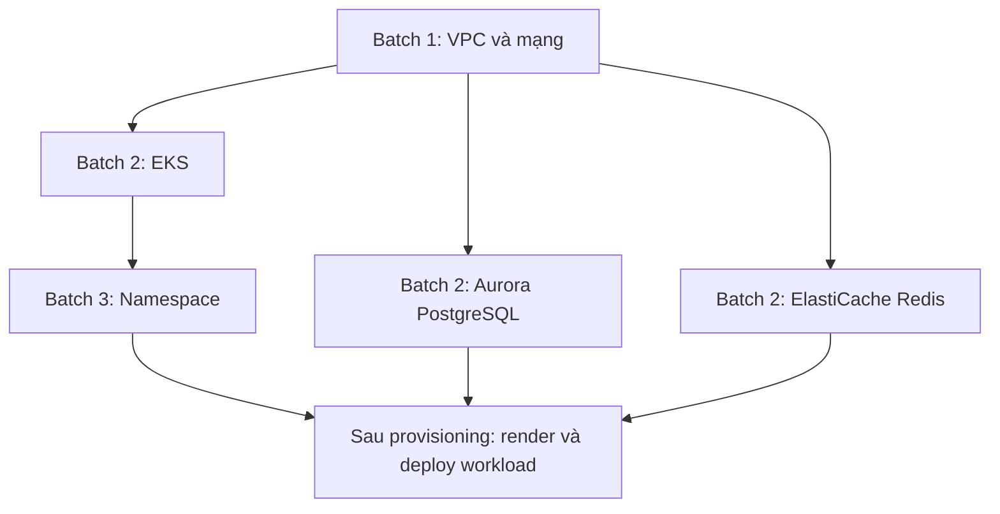

# Cơ chế cấp phát hạ tầng bằng Terraform

Tổng hợp cuộc trao đổi ngày 26-10-2026, phục vụ giải thích và trình bày.
Tài liệu này mô tả thiết kế và implementation hiện tại, kèm ví dụ giản lược;
không thay thế specification, architecture hoặc quyết định sản phẩm trong
`orchestrator_docs/`. Các ví dụ không phải bằng chứng của một lượt chạy mới.

## 1. Ai làm gì?

**Orchestrator lập kế hoạch và điều phối; Terraform tạo hoặc cập nhật hạ tầng.**
Developer khai báo ứng dụng cần gì. Platform Engineer cấu hình cách đáp ứng
nhu cầu đó. Platform chọn cấu hình phù hợp, chạy các bước theo dependency,
kiểm tra kết quả và đưa thông tin kết nối vào workload.

```text
Khai báo workload và nhu cầu tài nguyên
                  ↓
Match Resource Definitions và dựng dependency graph
                  ↓
Preview: xem tài nguyên, thay đổi và thứ tự cấp phát
                  ↓
Deploy: chạy từng resource theo dependency
                  ↓
Kiểm tra state, outputs và readiness
                  ↓
Render và triển khai workload
```

Các khái niệm chính:

| Khái niệm | Ý nghĩa | Ví dụ |
|---|---|---|
| Infrastructure/Driver Account | Danh tính thực thi đã được xác minh, thuộc Organization | AWS account hoặc kết nối Kubernetes |
| Resource Type | Hợp đồng input/output của một loại resource | PostgreSQL, Redis, cluster |
| Resource Definition | Cách hiện thực resource, driver/module, inputs, account, region và matching criteria | PostgreSQL chạy trong Kubernetes hoặc Aurora |
| Resource instance | Một resource cụ thể được platform quản lý theo identity/scope | Shared database của Environment staging |
| Terraform module | Mã IaC thực hiện cấp phát | Module Aurora tạo cluster và các DB instances |
| Terraform state | Ánh xạ giữa cấu hình Terraform và các objects đã quản lý | Aurora cluster ID và DB instance IDs |
| Outputs | Dữ liệu trả về để consumer sử dụng | Địa chỉ database, tên database, tham chiếu secret |

Account và region AWS đến từ Definition của từng node. Kubernetes consumers
tham chiếu cluster resource cụ thể. Hệ thống hiện không chọn hạ tầng bằng
execution profile cũ, không tự thêm VPC/EKS chỉ vì Environment là “cloud”.

## 2. Ví dụ thứ tự cấp phát trên AWS

Giả sử ứng dụng cần EKS, Aurora PostgreSQL và ElastiCache Redis. Definitions
khai báo EKS/database/cache dùng mạng của VPC; namespace dùng cluster EKS;
workload dùng namespace và outputs của database/cache.



Trong sơ đồ trình bày này, mũi tên đi từ provider sang consumer, nghĩa là “bên
trước phải sẵn sàng để bên sau sử dụng”. Graph nội bộ của planner lưu edge theo
chiều ngược lại: `consumer -> provider`.

| Thứ tự | Node | Inputs đáng chú ý | Outputs dùng tiếp |
|---|---|---|---|
| Batch 1 | VPC | CIDR, region, cấu hình mạng | VPC/subnet IDs |
| Batch 2 | EKS | Outputs mạng VPC, cấu hình cluster/node | Typed cluster target |
| Batch 2 | Aurora | Outputs mạng VPC, cấu hình database | Outputs kết nối PostgreSQL |
| Batch 2 | ElastiCache | Outputs mạng VPC, cấu hình cache | Outputs kết nối Redis |
| Batch 3 | Namespace | Cluster target từ EKS | Namespace và placement |
| Sau các batch | Workload | Namespace, database/cache bindings, image/config | Objects workload trên Kubernetes |

EKS, Aurora và Redis cùng batch vì trong ví dụ chúng không phụ thuộc nhau.
Các node cùng batch có thể chạy song song về mặt dependency; implementation
provisioning hiện duyệt và chạy từng node tuần tự. Batch cụ thể thay đổi theo
Definitions và các tham chiếu thực tế; managed database/cache không tự có
dependency vào EKS.

Nếu VPC thất bại, consumers của VPC bị chặn. Chỉ provider đã hoàn thành cùng
outputs/readiness hợp lệ mới cho phép consumer chạy.

### Vì sao triển khai ứng dụng không nằm trong resource batch?

Về luồng tổng thể, có thể gọi triển khai ứng dụng là nhóm cuối. Trong code,
Resource Provisioning chỉ chạy các resource batches; Workload Renderer/Deployer
chạy sau khi provisioning hoàn tất. Workload vẫn có dependencies trong graph.

```text
Resource batches: Terraform/existing-cluster adapter
                         ↓
Workload delivery: renderer → Kubernetes deployer
```

### Nếu dùng cluster có sẵn

ExistingClusterAdapter kiểm tra kết nối và trả cluster target. Terraform với
Kubernetes provider tạo namespace, PostgreSQL/Redis trong cluster theo Definitions.
Sau đó workload được triển khai. Cluster có sẵn không được platform tạo/xóa,
và bước kết nối này không tạo một Terraform state cho cluster.

## 3. Platform chạy một module như thế nào?

Lấy node Aurora làm ví dụ. Khi đến lượt node này, outputs mạng của VPC đã có.

1. **Xác định instance và state.** Tìm identity ổn định theo Organization,
   Application/Environment, generation, descriptor và scope; không tạo identity
   mới chỉ vì có một deployment/run mới.
2. **Ghim thông tin thực thi.** Lưu module, target, account/region, action và
   ownership trước side effect; giữ Environment operation claim và state locking.
3. **Lấy module đã xác minh.** Git module đã được inspect và chốt commit/digest;
   kiểm lại nội dung trước execution. Không tự lấy branch mới nhất khi Deploy.
4. **Resolve inputs.** Ghép cấu hình Definition, resource params và outputs VPC;
   lấy credentials riêng tư từ account đã ghim.
5. **Chuẩn bị invocation riêng.** Workspace riêng, binary/module đã xác minh,
   provider lockfile, variables, credentials và HTTP state backend nội bộ.
6. **Init, plan, kiểm tra rồi apply.** Platform từ chối plan không phù hợp policy;
   nếu không có thay đổi thì không chạy apply.
7. **Đọc và kiểm tra kết quả.** Đọc outputs/state resources, kiểm state đã được
   backend xác nhận, output contract và các readiness checks liên quan.
8. **Lưu kết quả và cho consumer tiếp tục.** Persist trạng thái, outputs an toàn
   và opaque secret refs; consumer nhận giá trị đã được kiểm tra.

Các lệnh dưới đây là minh họa đã giản lược, không phải script để chạy thủ công:

```bash
terraform init -input=false -get=false -lockfile=readonly
terraform plan -var-file=... -out=tfplan
terraform show -json tfplan
# Platform kiểm tra plan trước khi gọi apply.
terraform apply tfplan
terraform output -json
```

Runner thực tế truyền đầy đủ flags, deadline, đường dẫn private và backend
authentication. Terraform state được khóa qua backend; không dùng `-lock=false`.
Platform không kế thừa tùy tiện credentials/config của host.

### Có hai cấp “plan”

| Cấp | Thời điểm | Nội dung |
|---|---|---|
| Platform Preview/planning | Trước Deploy | Desired resources, matching, graph, inputs đã biết, outputs chưa biết có provenance, batches và classification |
| Terraform plan | Trong execution của từng module | Thay đổi cụ thể đối với objects module quản lý, dùng state và provider thực tế |

Preview không provision. Không nên hiểu Preview là một saved Terraform plan
duy nhất cho toàn ứng dụng. Terraform plan của từng invocation còn được kiểm
trước apply. UPDATE không được xóa hoặc replace objects hiện hữu.

## 4. Một resource có phải một state?

**Trong dự án này, mỗi resource instance do Terraform quản lý có một state riêng.**
Một instance có thể chứa nhiều objects bên dưới:

```text
VPC instance    → một state: VPC, subnets, route tables, security objects…
EKS instance    → một state: cluster, node group, IAM objects…
Aurora instance → một state: DB cluster, DB instances, security objects…
```

Ranh giới là instance được platform cấp phát qua module, không phải từng AWS
object. Hai instance cùng dùng một module vẫn có hai state. Module con bên
trong cùng một lần chạy không tự có state riêng.

```text
backend ──┐
          ├── cùng shared descriptor → một Aurora instance → một state
worker ───┘
```

Shared resource ở đây có identity theo Environment/generation; không suy ra
rằng database được chia sẻ xuyên mọi Application/Environment.

## 5. Chạy xong, platform quản lý gì?

Terraform CLI kết thúc sau invocation. Aurora/EKS/Redis tiếp tục chạy trên AWS.
Platform giữ hồ sơ quản lý, không giữ Terraform như một daemon chạy liên tục.

| Dữ liệu | Vai trò |
|---|---|
| Instance identity, descriptor và scope | Tìm đúng resource ở deployment sau |
| Module revision/digest, account/region và target gốc | Thực thi và cleanup đúng lịch sử |
| Terraform state riêng của instance | Ánh xạ tới objects thật |
| Outputs và secret refs | Cung cấp bindings cho consumer |
| Attempts, stages, status, ownership | Theo dõi tiến độ, lỗi và điều kiện cleanup |

State đi qua HTTP backend nội bộ, được lưu mã hóa trong PostgreSQL. Console
không công khai raw state, backend tokens hoặc credentials. Có Environment
operation claim cho pipeline và Terraform state lock cho instance. Việc hết
heartbeat không tự cấp quyền force-unlock.

### Deploy lại hoặc đổi cấu hình

- Tìm lại instance/state cũ, resolve inputs rồi plan để reconcile.
- Không có thay đổi: ghi nhận no-change, bỏ qua apply.
- Có cập nhật tại chỗ hợp lệ: apply vào state cũ, giữ identity.
- Plan đòi delete/replace trong UPDATE: chặn, không âm thầm phá và tạo lại.
- Sửa catalog Definition không tự đổi target/state gốc hoặc tự chạy hạ tầng;
  thay đổi cần đi qua planning và execution tường minh.

### Restart, lỗi và thành công một phần

State và hồ sơ bền vững cho phép backend nạp lại thông tin quản lý sau restart.
Điều này không đồng nghĩa tự động resume một apply bị gián đoạn.

Ví dụ VPC/EKS đã thành công nhưng Aurora lỗi: platform giữ kết quả của các
node đã hoàn tất và ghi failure của Aurora; không giả định toàn bộ deployment
đã rollback. Nếu provider có thể đã tạo object nhưng state chưa lưu hoặc outcome
chưa rõ, hệ thống giữ hold/evidence và chặn CREATE lại để tránh duplicate.

Retry transient được giới hạn và có kiểm tra state/kết quả thực tế. Tự động
recovery toàn bộ, orphan import/reconciliation và drift detection chưa được
coi là tính năng đã có trong phạm vi này.

### Xóa và cleanup

Xóa workload không tự động tương đương destroy toàn bộ hạ tầng. Xóa resource
là operation riêng kiểm quyền, consumers, ownership và tập tài nguyên được chọn.

```text
Gỡ workload/consumer trước
              ↓
Xóa namespace và các DB/cache đã được phép xóa
              ↓
Xóa EKS khi không còn dependency cần nó
              ↓
Xóa VPC sau các consumers của mạng
```

Thứ tự cụ thể là reverse dependency graph thực tế; nhánh lỗi không cho phép
xóa dependency vẫn còn cần. Destroy dùng module/state/target gốc, giữ shared
resource còn consumer và cluster có sẵn. Với các tài nguyên có kiểm tra native
API tương ứng, xác nhận absence sau destroy; không chỉ nhìn exit code Terraform.
Giữ terminal metadata/tombstone để audit.

## 6. Một ứng dụng dùng một state có đúng không?

**Có. Terraform không bắt buộc một resource platform phải có một state.** Một
cấu hình root trong một workspace có thể gọi nhiều module và quản lý tất cả
trong một state. Tên mặc định khi dùng local backend là `terraform.tfstate`;
remote backend không yêu cầu có file state trong repository.

```text
Root configuration app-staging
  ├── module VPC
  ├── module EKS
  ├── module Aurora
  └── module Redis
             ↓
         Một state
```

Trong cấu hình này, Terraform tự lập dependency và truyền outputs giữa các
module trong cùng một plan/apply. “Nhiều module” không đồng nghĩa “nhiều state”.
Một ứng dụng cũng có thể chia state theo environment hoặc theo nhóm network,
cluster, data, tùy ranh giới quản lý.

Nguồn: [Terraform state](https://developer.hashicorp.com/terraform/language/state),
[workspaces](https://developer.hashicorp.com/terraform/cli/workspaces),
[ví dụ chia cấu hình trong HCP Terraform](https://developer.hashicorp.com/terraform/cloud-docs/workspaces).

## 7. So sánh hai cách và chi phí phức tạp

| Tiêu chí | Một cấu hình/state cho bộ hạ tầng ứng dụng | State riêng theo instance như dự án |
|---|---|---|
| Đơn vị gọi Terraform | Cả bộ | Từng instance |
| Dependency giữa các module | Terraform xử lý trong root configuration | Platform xử lý giữa các invocations |
| Truyền outputs | Tham chiếu trực tiếp giữa module | Platform thu, kiểm tra, lưu và truyền |
| Plan tổng thể | Một plan cho bộ objects | Các plan riêng cho từng instance |
| Lifecycle | Quản lý trong một state | Quản lý theo instance và consumer graph |
| Phần platform phải xây | Chuẩn bị root config/inputs và vận hành run | Thêm điều phối, outputs, partial failure, locks và cleanup xuyên state |
| Thích hợp để cân nhắc | Bộ hạ tầng tương đối cố định | Catalog resource và matching/driver linh hoạt |

**Cách hiện tại phức tạp hơn cho người xây platform.** Nó không mặc nhiên tốt
hơn chỉ vì giống Humanitec. State riêng không tự bảo đảm an toàn: platform phải
thực hiện đúng toàn bộ dependency, ownership và lifecycle guards.

Một state vẫn có thể phục vụ cấu hình linh hoạt nếu sinh root configuration,
dùng variables/conditionals và các module phù hợp. Đổi lại phải quản lý việc
tổng hợp và thay đổi cấu hình đó. Đây là hai cách phân bố trách nhiệm, không
phải một giới hạn kỹ thuật buộc phải chọn nhiều state.

Nếu mục tiêu chỉ là “dựng một bộ hạ tầng cố định cho mỗi ứng dụng/môi trường”,
một state cho cả bộ là lựa chọn đơn giản hơn để cân nhắc. Nếu mục tiêu là
platform có Resource Types, matching, shared/private instances và nhiều driver,
cách hiện tại có lý do kiến trúc. Nhận xét này không thay đổi quyết định của repo.

## 8. Giống Humanitec ở đâu?

Humanitec mô tả Terraform Driver theo luồng: match Definition, nhận inputs,
khởi tạo runner, chạy Terraform, xử lý state và trả outputs cho Orchestrator.
Đó là mô hình tương tự cơ chế trong dự án.

Tài liệu Humanitec cho thấy runner/backend có nhiều lựa chọn; không nên suy ra
họ dùng cùng HTTP backend PostgreSQL, cùng locks hoặc cùng implementation
như repo này. Terraform/OpenTofu Container Driver có thể chạy bằng Kubernetes
Job. Mô hình giống nhau không chứng minh tương thích API hoặc lifecycle 100%.

Nguồn chính thức:

- [Terraform Driver](https://developer.humanitec.com/platform-orchestrator/docs/integration-and-extensions/drivers/generic-drivers/terraform/).
- [Terraform/OpenTofu Container Driver](https://developer.humanitec.com/platform-orchestrator/docs/integration-and-extensions/drivers/terraform-and-opentofu-container-builtin/).

### Vì sao Humanitec chọn ranh giới resource?

Các dữ kiện được tài liệu chính thức mô tả:

- Resource Graph được hình thành từ nhu cầu developer và Resource Definitions;
  references/co-provisioning có thể mở rộng graph và dependency.
- Active Resources có descriptor/identity; hỗ trợ private/shared trong
  Environment. Một resource có thể đại diện nhiều objects hoặc kết nối object
  đã tồn tại.
- Drivers có thể dùng các cơ chế khác nhau, bao gồm Terraform và các IaC khác.

Nguồn: [Resource Graph](https://developer.humanitec.com/platform-orchestrator/resources/resource-graph/),
[Active Resources](https://developer.humanitec.com/platform-orchestrator/docs/platform-orchestrator/resources/active-resources/),
[Drivers](https://humanitec.com/open-source-drivers).

**Diễn giải kiến trúc từ các dữ kiện trên:** đơn vị resource giúp ghép các
implementation theo nhu cầu deployment, tái sử dụng Definition và giữ lifecycle
riêng. Orchestrator có thể phối hợp Terraform với driver khác trong một graph.
Platform nhận thêm độ phức tạp để developer khai báo nhu cầu thay vì duy trì
một root Terraform hoàn chỉnh cho từng tổ hợp.

Đây không phải tuyên bố chính thức rằng Humanitec không thể dùng module lớn
hoặc một state cho nhiều objects. Một Definition Terraform vẫn có thể provision
nhiều objects. Điều quan trọng là ranh giới resource mà platform nhìn thấy.

## 9. Nguồn chuẩn và đường dẫn code trong repo

- [Documentation index](../orchestrator_docs/INDEX.md).
- [Trạng thái triển khai và giới hạn hiện tại](../orchestrator_docs/CURRENT_STATE.md).
- [UC-08: provisioning, outputs, reuse và completion](../orchestrator_docs/usecase/UC-08/specification.md).
- [ADR-017: Definition dependencies, account/target và cleanup](../orchestrator_docs/architecture/decisions/ADR-017-definition-dependency-execution.md).
- [Module contract: Git pins, verification và provider bindings](../orchestrator_docs/architecture/contracts/terraform-modules.md).
- [State contract: identity, encryption, locks, retry và cleanup](../orchestrator_docs/architecture/contracts/terraform-state.md).
- [Provisioning service: duyệt batches, resolve inputs và persist outputs](../backend/internal/application/provisioning/service.go).
- [Terraform execution: init, plan, review và apply](../backend/internal/application/tfexec/run.go).
- [CLI runner: workspace, subprocess và các lệnh Terraform](../backend/internal/adapters/terraform/runner/runner.go).
- [Destroy execution](../backend/internal/application/tfexec/destroy.go).
- [Các modules đóng gói trong repo](../backend/internal/adapters/terraform/modules/).

Trạng thái tại ngày tổng hợp đã có bằng chứng Kubernetes/AWS thật trong
CURRENT_STATE. Tài liệu này không chạy lại cloud/cluster và không khẳng định
mọi cấu hình hay mọi provider đều đã được kiểm chứng runtime.
